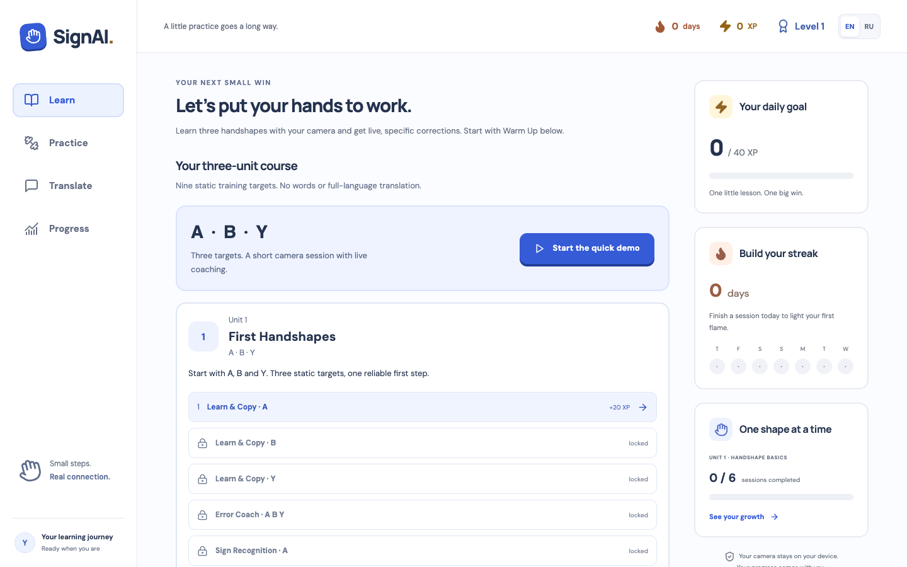
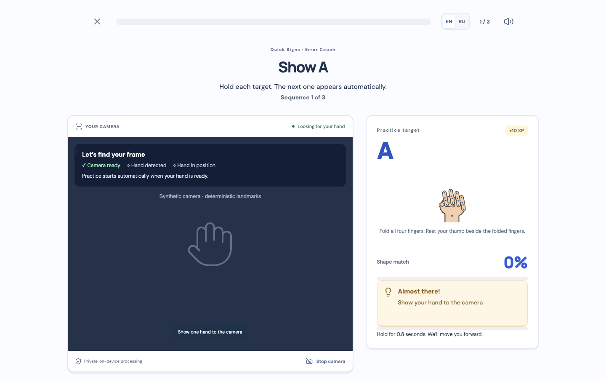
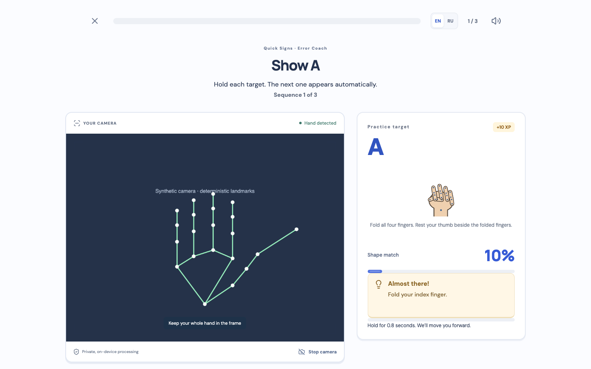
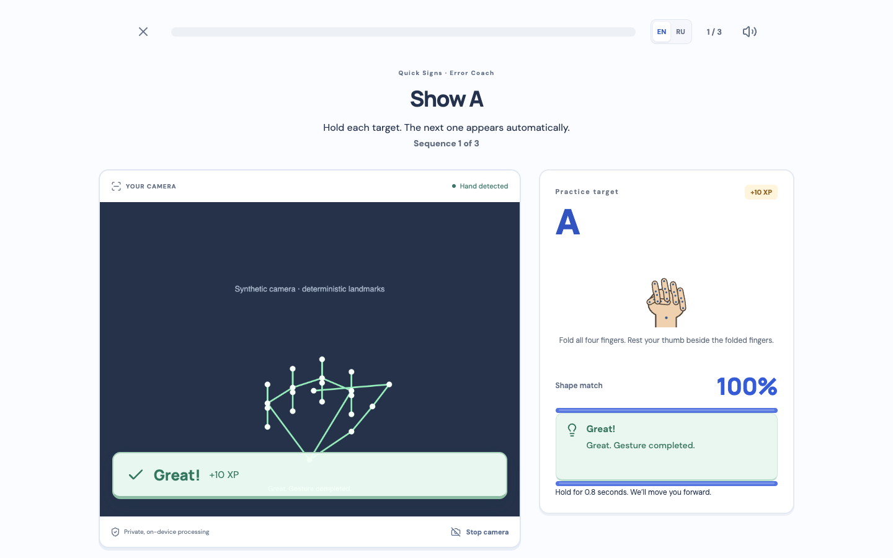
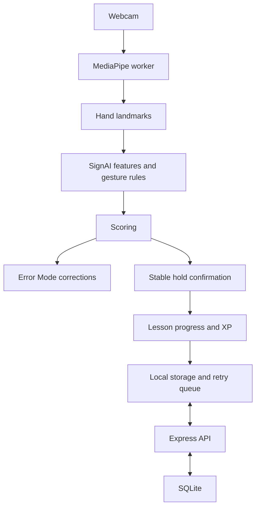
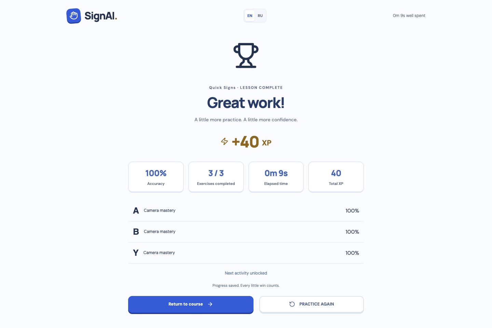
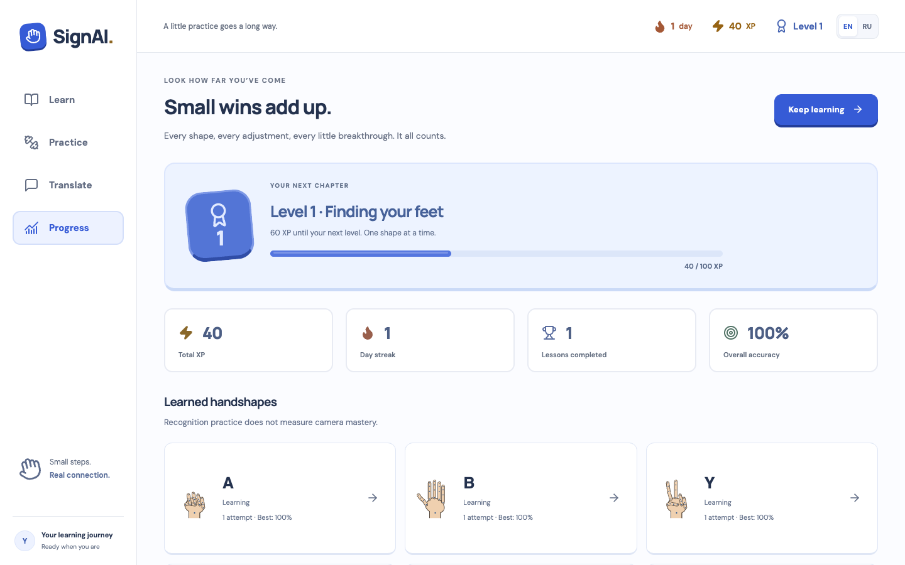

# SignAI

Practice handshapes with real-time webcam feedback.

  

We built SignAI for the ADMIT Hackathon. A learner sees a target handshape, repeats it in front of a normal webcam and receives a specific correction when the pose is inaccurate.

## Hackathon

**ADMIT Hackathon — Case: Motion — Camera Instead of Joystick**

The webcam is the input: hold a recognized handshape to advance through a lesson. The prototype includes nine static targets, visible recognition feedback, Error Mode and saved lesson results.

## Demo

Deployment link will be added before submission.

## Product

<table>
<tr>
<td></td>
<td></td>
</tr>
<tr><td>Learning path</td><td>Webcam trainer</td></tr>
</table>

These are screenshots of the running app. Camera views use the repository's deterministic test landmarks and a synthetic camera stream, not a webcam photograph. The scripted demo completed a lesson and saved its results through the real API. These captures do not establish physical-webcam accuracy; we still want a real human webcam capture before submission.

## What we built

The learning path introduces a handshape, gives the learner time to copy it, then checks recall. MediaPipe tracks the hand; our gesture engine evaluates the pose. Once the learner holds a correct shape, the exercise moves on and saves XP and progress.

The interface works in English and Russian. Practice revisits weak or recently missed shapes. A small translator prototype collects recognized labels from the supported vocabulary; it does not translate full sign-language sentences.

## Error Mode

MediaPipe supplies hand landmark positions. The correction logic is ours: feature extraction, finger-state analysis, gesture rules, scoring, feedback priority and hold confirmation.

The engine can give corrections such as:

- “Straighten your index finger.”
- “Fold your ring finger.”
- “Move your hand toward the center.”
- “Turn your palm slightly toward the camera.”

Feedback selects a correction to work on, then checks the next frame. A correct pose must stay stable for 0.8 seconds before it counts.

<table>
<tr>
<td></td>
<td></td>
</tr>
<tr><td>Specific correction</td><td>Successful hold</td></tr>
</table>

## How it works



## Features

- Three units with 27 activities, checkpoints and a short three-target demo.
- Webcam tracking, pose scores, correction feedback and continuous hold confirmation.
- XP, levels, streaks, daily goals, mastery and session history.
- Practice for weak or recently missed shapes, plus the supported-label translator.
- Responsive layouts and EN/RU controls.
- Local progress with queued API sync: an already-loaded session can continue when the backend is unavailable and retry after reconnecting. This is not a fully offline app install.
- One tracker can detect two hands and choose the matching hand. The course uses single-hand targets; a separate development exercise tests two-hand rules.

<table>
<tr>
<td></td>
<td></td>
</tr>
<tr><td>Lesson results</td><td>Saved progress</td></tr>
</table>

## Supported handshapes

| Unit | Implemented targets |
| --- | --- |
| First Handshapes | А · В · Ү |
| Finger Control | О · У · И |
| Precision | Л · М · Н |

All nine have automated landmark tests for left and right hands. We have not completed physical-webcam validation of all nine. The older palm, fist and victory demo remains available for diagnostics.

## Exercise types

- **Learn & Copy:** copy the visible reference and hold it.
- **Error Coach:** use live corrections to adjust the pose.
- **Camera Recall:** recall a shape, with a hint available if needed.
- **Sign Recognition:** choose the matching label without using the camera.
- **Quick Signs:** hold a sequence of targets that advance automatically.
- **Checkpoint:** complete a mixed review to unlock the next unit.

## Languages

English and Russian. Switching language preserves the active camera, score and lesson state.

## Tech stack

| Area | Tools |
| --- | --- |
| Frontend | React 19, TypeScript, Vite, MediaPipe Tasks Vision |
| Recognition | Custom TypeScript gesture engine, browser worker |
| Backend | Node.js, TypeScript, Express, Zod |
| Storage | Node's built-in SQLite, localStorage and a retry queue |
| Tests | Vitest, Supertest, Playwright with Chrome |

## Run locally

Use **Node.js 22.13 or newer** and npm. You need access to this repository to clone it.

```sh
git clone https://github.com/sososu-iwia/admit_hackton_silexie_e.git
cd admit_hackton_silexie_e
npm install
npm run dev
```

Installation prepares the local MediaPipe WASM assets and tracking worker. The development command starts both servers:

- Frontend: http://localhost:6767 — open http://localhost:6767/learn
- Backend: http://localhost:6768
- Health: http://localhost:6768/api/health

Allow camera access when prompted. Modern browsers support camera access on localhost. Development ports are defined in `shared/development.ts`; Vite proxies `/api` to the backend. Production overrides remain environment-based (`PORT`, `VITE_API_BASE_URL`, `SIGNAI_ALLOWED_ORIGIN`, `SIGNAI_DB_PATH`).

## Development diagnostics

Open http://localhost:6767/trainer/handshape-basics?diagnostics=1 for tracking quality, gesture scores and recognition details used during calibration. This is a development view, not part of the normal lesson flow.

## Tests

Install Google Chrome before running the browser suite; Playwright is configured to use its `chrome` channel.

```sh
npm test
npm run test:e2e
npm run typecheck
npm run lint
npm run build
```

Final PART 2 check: **101 unit/API tests** and **33 browser/E2E scenarios** passed. Typecheck, lint and the production build also passed. The setup commands above were checked in a fresh clone.

## Privacy

Camera frames are processed in the browser. The app does not upload or store raw webcam video. The backend stores attempts and lesson results in SQLite; the browser also stores progress and preferences locally.

This prototype uses one shared demo identity. It does not yet provide accounts or isolate progress between users of the same backend.

## Current limitations

SignAI is a hackathon prototype with a small static vocabulary. Lighting, framing and hand position affect tracking. Natural sign languages also use movement, two hands, facial expressions and body posture; recognizing these handshapes is only a small part of that.

The translator is limited to implemented labels. We still need broader webcam testing and review with sign-language specialists and community members.

## Team

- Damir — [sososu-iwia](https://github.com/sososu-iwia)
- Kausar Tukezhan — [KausarTukezhan](https://github.com/KausarTukezhan)
